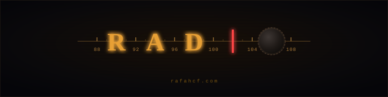

<p align="center">
  <a href="https://rafahcf.com">
    
  </a>
</p>

<h1 align="center">Rafael Camargo</h1>

<p align="center">
  <strong>Software engineer with 10+ years of experience. I build things - like this.</strong><br>
  <sub>A portfolio you tune into.</sub>
</p>

<p align="center">
  <a href="#about">About</a> ·
  <a href="#on-the-air">On the air</a> ·
  <a href="#behind-the-radio">Behind the radio</a> ·
  <a href="#run-locally">Run locally</a>
</p>

<p align="center">
  <a href="https://dart.dev"></a>
  <a href="https://docs.jaspr.site"></a>
  
</p>

<p align="center">
  <a href="https://rafahcf.com"><strong>► Switch it on at rafahcf.com</strong></a>
</p>

---

## About

My work, music, and pixel art share the same radio. Turn it on, move the dial, and the static gives way to a station. Each frequency reveals something different: a project, an idea, a story, or a small puzzle.

I wanted exploring the site to feel like finding something on the air. The screen flickers, signals drift into focus, and songs emerge from the noise as you tune. The receiver itself is part of the work.

## On the air

Fifteen stations across two bands, broadcasting A Wired Spine.

The Tropelorio station links to [its website](https://tropelorio.com), [Google Play](https://play.google.com/store/apps/details?id=com.rafahcf.tropelorio), and the [App Store](https://apps.apple.com/app/tropelorio/id6820841164).

- **FM** carries featured projects and stories, including Criptomano, DeTodoUIS, A Wired Spine, DMTFY, and a little about me.
- **AM** carries early ideas, In This New World, and the Pixel Art gallery. Find **1440** to assemble the artwork and reveal the original pieces.
- **MEM** saves a station once you've tuned into it. Tap a saved preset to return, or hold it to clear.

The interface is available in English and Spanish. Tune with touch, the mouse wheel, or the arrow keys; adjust the volume and explore at your own pace. Your saved stations and completed puzzles will be there when you return.

## Behind the radio

The app is written in **Dart**, using **Jaspr** to build a static website hosted on **GitHub Pages**.

A few things that make the receiver work:

- **Sound responds to the dial.** The Web Audio API generates the static and tuning whistle in real time. Recorded songs fade in as you approach a station, processed to sound like they're coming through a radio.
- **The receiver is drawn with CSS.** The screen glow, scanlines, distortion, and power-on animation use CSS. Project logos and original artwork provide the image content.
- **Small interactions carry the experience.** Each band remembers where you left the dial, the faceplate names the song playing, and pixel-art puzzles reveal their colour as you solve them.
- **Keyboard and motion preferences are considered.** Controls support keyboard use, dialogs manage focus, and animations adapt to reduced-motion settings.

Jaspr lets the interface and browser interactions stay in one language while producing HTML, CSS, and JavaScript that can be served as a static site.

For a closer look, start with [`lib/app.dart`](lib/app.dart), the [station list](lib/models/station.dart), or the [notes on the soundtrack](web/audio/README.md).

## Run locally

Requires **Dart 3.10+**.

```bash
dart pub global activate jaspr_cli 0.23.3
dart pub get
jaspr serve
```

To create the production build:

```bash
jaspr build
```

Output goes to `build/jaspr/`. Pushes to `main` deploy automatically to GitHub Pages through the [deployment workflow](.github/workflows/deploy.yml).

<details>
<summary>Development tools</summary>

```bash
# Analyze and format the Dart code
dart analyze
dart format --line-length 120 .

# Check the colour pairs used in the contrast audit
dart run tool/check_contrast.dart

# Regenerate the social preview image
dart run tool/generate_og_image.dart

# Regenerate pixel-art sprites and rewards
dart run tool/generate_pixel_css.dart --dart
```

Components live in `lib/components/`, station and artwork data in `lib/models/`, and static assets in `web/`.

</details>

---

All rights reserved.

<p align="center">
  <sub>Built with Jaspr · Dart · CSS · Web Audio API</sub><br>
  <a href="https://rafahcf.com"><sub>rafahcf.com</sub></a>
</p>
